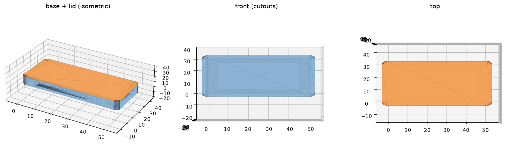
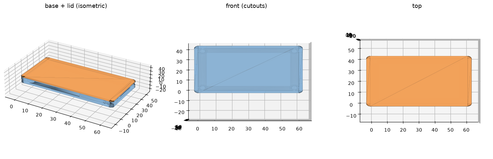

# kicad-enclosure

Generate a printable 3D enclosure (a base and a removable lid) straight from a
KiCad PCB file. Point it at a `.kicad_pcb` and it produces watertight STEP +
STL files ready for your slicer — no CAD package, no manual modelling.

```
kicad-enclosure board.kicad_pcb
```

runs the whole pipeline:

1. **Parse** the board with `kicad_parser` — extracts the board outline,
   mounting holes, component bounding boxes, and connector/cutout hints.
2. **Generate** a parametric base + lid with `kicad_enclosure` (build123d) —
   walls, floor, standoffs, vents, connector cutouts, and optional wall mount.
3. **Export** STEP (editable master) and STL (slicer-ready) for both parts.





*(Left: assembled base + lid isometric · middle: front view showing cutouts ·
right: top view. Blue = base, orange = lid.)*

## Installation

Requires Python **3.10+**.

```bash
pip install kicad-enclosure
```

`build123d` (which pulls in OpenCascade) is the only runtime dependency. The
KiCad parser is pure standard library — no KiCad installation is required.

> **Note:** the package is not on PyPI yet; it ships as soon as the initial
> release is tagged. Until then, install from a checkout:

```bash
git clone https://github.com/heartland-eng/kicad-enclosure
cd kicad-enclosure
pip install .
```

## Usage

### Zero-config

```bash
kicad-enclosure board.kicad_pcb
```

Writes four files into the current directory using the board's file name:

```
board_base.step   board_base.stl
board_lid.step    board_lid.stl
```

### Options

```bash
# choose output directory, base name, and formats
kicad-enclosure board.kicad_pcb -o out --name my_case --format both

# thicker walls, more clearance, wall-mount tabs, custom vents
kicad-enclosure board.kicad_pcb \
    --wall-thickness 3 \
    --clearance 3 \
    --mount-style dual_tab \
    --vent-count 8 --vent-width 4

# map a connector by reference designator to a cutout
kicad-enclosure board.kicad_pcb --cutout-override J1=usb_c --cutout-override J2=rj45

# inspect the parsed geometry as JSON (no CAD step)
kicad-enclosure board.kicad_pcb --only-parse
```

Run `kicad-enclosure --help` for the full list.

### Connector cutout config file

`--cutout-config FILE` reads a JSON file that maps reference designators to
cutout hints, and can also carry default enclosure parameters:

```json
{
  "cutout_overrides": {
    "J1": "usb_c",
    "J2": "rj45",
    "J3": "hdmi",
    "J4": "barrel",
    "J5": "header"
  },
  "config": {
    "wall_thickness": 2.5,
    "cutout_clearance": 0.75
  }
}
```

Supported cutout hints: `none`, `usb_a`, `usb_c`, `usb_micro`, `rj45`, `hdmi`,
`display`, `sd`, `barrel`, `header`, or any custom string. Values in `config`
are merged with the CLI flags — an explicit command-line flag always wins.

## Command-line reference

| Flag | Default | Meaning |
|------|---------|---------|
| `board` | — | path to the `.kicad_pcb` file (positional) |
| `-o, --output` | `.` | output directory |
| `--name` | board file name | base name for output files |
| `--format` | `both` | `step`, `stl`, or `both` |
| `--only-parse` | off | print `enclosure-data-v1` JSON and exit |
| `--wall-thickness` | `2.0` | wall shell thickness (mm) |
| `--clearance` | `2.0` | air gap above the tallest component (mm) |
| `--clearance-xy` | `0.4` | board-to-wall clearance in X/Y (mm) |
| `--floor-thickness` | `2.0` | base floor thickness (mm) |
| `--lid-thickness` | `2.0` | lid top-plate thickness (mm) |
| `--standoff-height` | `5.0` | board standoff height (mm) |
| `--fillet-radius` | `0.5` | outer vertical edge fillet (mm, 0 disables) |
| `--vent-count` | `5` | vent slots per wall (0 disables) |
| `--vent-width` | `3.0` | vent slot width, short dimension (mm) |
| `--vent-length` | `20.0` | vent slot length, long dimension (mm) |
| `--vent-location` | `walls` | `walls`, `lid`, or `both` |
| `--mount-style` | `none` | `none`, `dual_tab`, or `din_rail` |
| `--cutout-clearance` | `0.5` | extra margin around connector openings (mm) |
| `--cutout-config` | — | JSON file with `cutout_overrides` and/or `config` |
| `--cutout-override` | — | `REF=HINT`, repeatable |
| `--component-height` | `5.0` | default component height (mm, KiCad stores none) |
| `--board-thickness` | `1.6` | fallback board thickness (mm) when file omits it |

All dimensions are in millimetres.

## What gets generated

- **Base** — floor plus shelled walls at the board outline + clearance, with
  standoffs (and self-tapping pilot bores) under each mounting hole, vent slots
  on the two longest non-cutout walls, and rectangular connector cutouts
  punched through the wall face nearest each edge-mounted connector.
- **Lid** — a top plate with a press-fit lip that seats inside the base.
- **Wall mount** — optional `dual_tab` (two screw tabs) or a simplified
  `din_rail` (TS35) channel on the back face.

The base and lid are generated as independent solids (never fused), so the lid
separates cleanly for printing. Every STL is watertight with positive volume.

## Python API

Both sub-packages are importable directly:

```python
from kicad_parser import parse_file, to_dict          # board -> enclosure-data-v1
from kicad_enclosure import generate_from_dict, export_enclosure

doc = to_dict(parse_file("board.kicad_pcb"))
result = generate_from_dict(doc)                       # EnclosureResult(base, lid, ...)
manifest = export_enclosure(result.base, result.lid, "out", "board")
```

`kicad_parser` targets the KiCad 6+ s-expression format (with best-effort
KiCad 5 legacy support); `kicad_enclosure` consumes the `enclosure-data-v1`
JSON contract (see `docs/` for the schema).

## Development

```bash
pip install -e ".[dev]"
python -m unittest tests.test_parser      # parser unit tests (stdlib-only, no CAD)
python tests/run_tests.py                 # end-to-end CLI tests against real fixtures
python scripts/render_previews.py         # regenerate the README screenshots
```

The test suite drives the CLI against four real KiCad fixtures and asserts on
the produced STEP/STL files, `--format` filtering, cutout overrides, and STL
watertightness.

## Limitations

- KiCad stores no component height, so a default is used unless you set
  `--component-height` or a per-ref override.
- The DIN-rail clip is a simplified TS35 approximation, not a certified mount.
- Connector cutouts are rectangular openings sized from the component bounding
  box + clearance; exotic footprints may need a manual touch-up.

## License

MIT — see [LICENSE](LICENSE).
